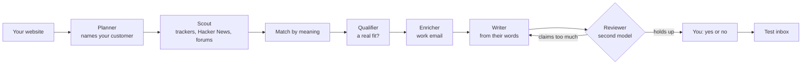

# Overheard

**Find the people already describing the problem you solve.**

Cold outreach fails because the sender does not know whether this person has this problem *now*. So they email everyone. Overheard reads what people wrote in public, keeps those describing a problem you solve, and shows you their words before anything is drafted.

Live: <https://earshot-production.up.railway.app> · Built solo at HackwithBay 4.0

## The impact we are after

| Today | With Overheard |
|---|---|
| Days building a list and guessing who cares | Paste a website, get named people in two minutes |
| A thousand emails to people without the problem | A handful to people who said, in public, that they have it |
| A template: "Hi {first_name}" | A note about the exact thing they wrote |
| No reason given for a lead | Every lead links to its evidence |

Fewer, truer messages are better for the sender and for everyone's inbox. Measured so far: across ten simulated product types, leads judged relevant rose from **35% to 82%** once weak matches were declined. Not measured: reply rates. No message has gone to a real person.

## How it works

Paste your website. That is the whole input.



## One real run, on flexprice.io

```
Posts read               463  ████████████████████████████████
People with the problem   41  ███
Worth writing to           8  ▌
Messages drafted           7  ▌
Flagged by the Reviewer    4  → 3 rewritten and passed, 1 held for you
```

It named the customer as *backend engineers building billing at AI-native SaaS companies*. Results vary: today's runs kept 4 to 8 people.

## Why you can trust it

| Claim | How it is enforced |
|---|---|
| **Verifiable** | No evidence link, no person. Every lead opens the post they wrote. |
| **Honest drafts** | A second model checks each message against that post. One rewrite, then held. |
| **Earned autonomy** | Five trust checks before it may send alone. One bad send revokes it. |
| **It says no** | It declined a portfolio site: "the buyers are recruiters, not developers describing problems in public." |
| **Safe by construction** | Nothing is sent to the person in this build, only to a test inbox. |

## What powers it

| Tool | Job | Measured today |
|---|---|---|
| Claude | Plans, qualifies, writes | 27 calls a run |
| Moss | Matches posts to pains by meaning | precision 1.00 |
| Tavily | Reads your site, searches forums | 10 searches a run |
| Hunter | Verifies work emails | 5 of 5 domains |
| SubQ | Second opinion on every draft | 6 of 6 correct |
| Flexprice | Meters and gates every action | wallet moves in 1.3 s |
| Kùzu | Graph of people, pains, competitors | 5 graph queries |
| Band | Four agents built and reviewed a rule | [transcript](docs/band-run.md) |

Reproduce: `python scripts/eval_tools.py` ([details](docs/eval.md)).

## Run it

```bash
uv venv --python 3.12 && uv pip install -r requirements.txt
cp .env.example .env          # fill in your keys
.venv/bin/uvicorn app.main:app --port 8765
```

Open <http://localhost:8765>. Anthropic and Moss keys are required; the rest are optional.

```bash
.venv/bin/python -m pytest -q          # 462 tests
.venv/bin/python scripts/smoke.py      # 16 end-to-end checks, writes nothing
claude mcp add --transport http overheard https://earshot-production.up.railway.app/mcp
```

The last line connects your own agent: six read-mostly tools. Approving and sending are not exposed.

## What it will not do

- Work when buyers do not write in public. It says so and stops.
- Write to an unnamed forum post. Evidence only.
- Send sequences or LinkedIn messages. One email per person.
- Run on autopilot yet. That needs eight of your decisions.

## Read more

[Architecture](docs/architecture.md) · [Spec coverage](docs/spec-coverage.md) · [Reference](docs/reference.md) · [Security](docs/security.md)
