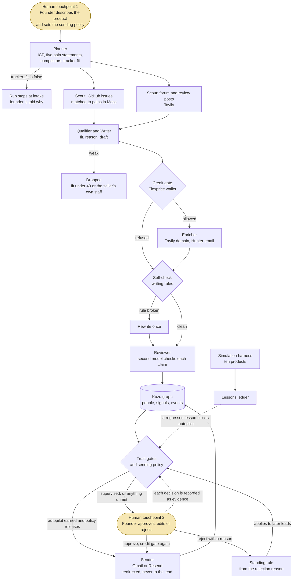

# Earshot: system design and architecture

This document describes what the code does today. Where something is partial, untested or missing, it says so, and the last section collects those points. Setup is in the [README](../README.md). The reasons behind each decision are in [log.md](log.md).

## 1. Overview

Earshot takes a description of a product (typed, or read from a website or GitHub repository) and runs a line of seven agents: Planner, Scout, Qualifier, Enricher, Writer, Reviewer and Sender. The line ends in a drafted message with the person's own words as evidence. A human decides on each message, or, once five trust gates have been earned, the Sender releases messages that pass the sending policy. Messages are always redirected to the founder's own inbox or a demo inbox. No lead is ever emailed.

Code layout, one file per concern:

| File | Concern |
| --- | --- |
| `app/main.py` | HTTP API and the two HTML pages. No auth. |
| `app/intake.py` | Website or repository to product text. Pure functions, injectable readers. |
| `app/pipeline.py` | Planner, Scout (GitHub and Moss), Qualifier and Writer, Enricher call, check-and-rewrite loop, graph write. |
| `app/scout_web.py` | Second Scout: forum and review posts through Tavily. |
| `app/enrich.py` | Company domain (Tavily) and email find and verify (Hunter). |
| `app/scoring.py`, `app/checks.py` | The score formula and tiers; the per-lead rule checks. |
| `app/reviewer.py` | Claim check with a second model. |
| `app/policy.py`, `app/trust.py` | What may be released; which autonomy level has been earned. |
| `app/autopilot.py` | State behind the Floor view, the Reviewer's records, and the Sender. |
| `app/billing.py` | Credit gate and metering, local wallet or Flexprice. |
| `app/mailer.py`, `app/gmail.py` | Redirected sending through Gmail or Resend. |
| `app/store.py` | Kuzu graph: schema and every read and write. |
| `app/simulate.py`, `app/lessons.py` | Regression harness and the ledger of mistakes. |
| `app/voice.py` | Spoken words to one of nine allowed actions; spoken replies. |
| `static/` | Plain HTML, CSS and JS with no build step. |

## 2. The agent line



The two human touchpoints are the founder's input at the start (what you sell, and the sending policy) and the decision on each message. Touchpoint 2 is also where trust is earned: every decision is stored next to what the agent would have done, and that record feeds the agreement gate.

How a run is driven. `POST /api/run` starts one background thread and refuses a second run while one is in progress (HTTP 409). The thread writes progress lines to `pipeline.state`. A line written as `Scout → Qualifier: text` is also stored as a handoff event, which the Floor view draws. After the run, `autopilot.after_run()` calls the Sender.

### Agents

| Agent | Input | Output | Service or model | Decides alone |
| --- | --- | --- | --- | --- |
| Planner | Product text (typed, or read by `intake.py` from a site through Tavily or a repository through the GitHub API) | ICP with a confidence per field, five pain statements, negative signals, competitors with category and repository, adjacent segments, and `tracker_fit` | Claude (`claude-sonnet-5-5`, overridable with `LLM_MODEL`) with structured output; GitHub API to check that each named competitor repository exists | Whether the run stops at intake (`tracker_fit` false). Which competitor repositories to watch; made-up ones are dropped. It only suggests adjacent segments. |
| Scout | Pain statements, repositories | Posts with author, URL, date, best-matching pain and match score | GitHub REST search, Moss; Tavily for forum and review sites | Which posts count as a match: Moss score of at least 0.3 for issues, Tavily score of at least 0.45 for web posts. Caps the list at 25 people, with up to 8 reserved for web voices. |
| Qualifier | One person's posts and GitHub profile, plus the ICP | `fit` 0 to 100, `production_user`, role, a one-sentence reason | Claude (same call as the Writer) and the GitHub users API | Drops people with fit under 40, and people whose company is the seller's own. |
| Enricher | Name and company | Domain, email, verification status, position, LinkedIn URL | Tavily, Hunter | Skips the paid lookup for weak leads without a public address, and when the credit gate refuses. |
| Writer | The Qualifier's evidence | Subject (under 8 words) and body (under 90 words) | The same Claude call as the Qualifier (`Qualification` in `pipeline.py`) | Rewrites its own draft once when a writing rule is broken. |
| Reviewer | A lead and its draft | Rule findings; per-sentence support probabilities; a verdict of pass, fail or unchecked | `checks.py` (code); SubQ Snap `subq-snap-1.2`, a different model from the Writer | Nothing is blocked outright. A finding holds the lead for the human. It cannot approve anything. |
| Sender | Pending leads, policy, trust level, credit balance | A stage change and a redirected email | `policy.py`, `trust.py`, Flexprice gate, Gmail or Resend | Releases a message only when the level is autopilot, the policy says release and the credit gate allows it. Steps itself down when an enforced gate fails. |

In the code the Qualifier and the Writer are one model call. The Floor view draws them as two stations.

## 3. Graph ontology

The graph is Kuzu, embedded, at `data/graph.kuzu` (`GRAPH_PATH` overrides). The schema is created at import in `app/store.py`:

```
CREATE NODE TABLE Person(login STRING PRIMARY KEY, name STRING, url STRING,
    company STRING, email STRING, blog STRING, bio STRING, location STRING, followers INT64,
    role STRING, fit INT64, production BOOLEAN, reason STRING, score INT64, tier STRING,
    stage STRING, stage_actor STRING, subject STRING, body STRING, draft_status STRING,
    email_status STRING, domain STRING, linkedin_url STRING, position STRING, enrich STRING, newest STRING)
CREATE NODE TABLE Company(name STRING PRIMARY KEY)
CREATE NODE TABLE Repo(name STRING PRIMARY KEY, kind STRING)     -- kind: product | competitor | web
CREATE NODE TABLE Signal(id STRING PRIMARY KEY, url STRING, title STRING,
    excerpt STRING, created STRING, pain STRING, match DOUBLE)
CREATE NODE TABLE Event(id STRING PRIMARY KEY, ts STRING, login STRING,
    actor STRING, action STRING, detail STRING)
CREATE REL TABLE WORKS_AT(FROM Person TO Company)
CREATE REL TABLE RAISED(FROM Person TO Signal)
CREATE REL TABLE ABOUT(FROM Signal TO Repo)
```

Meaning of the main properties:

- `Person.login` is the GitHub login, or `host/handle` or a post id for a web lead.
- `stage` is one of `Matched`, `Contacted`, `Replied`, `Meeting Booked`, `Closed/Lost`. `stage_actor` is `agent` or `rep` and records who moved it last. `draft_status` is `pending`, `approved` or `rejected`.
- `Signal` is one public post. `match` is the Moss score (or the Tavily score) against the pain in `pain`. Its `url` is the citation.
- `Event` is the audit log. `actor` is `agent` or `rep`; `login` points at a Person by value, not by an edge.

The ontology is small on purpose. Two things to know:

- `Company` nodes and `WORKS_AT` edges are written on every run, but no query reads them. The company shown in the app comes from `Person.company`.
- The graph is wiped (`MATCH (n) DETACH DELETE n`) and rebuilt at the end of each run. It does not accumulate across runs.

Queries the app runs, quoted from the code:

```cypher
-- store.leads(): every person, then each person's evidence two hops out
MATCH (p:Person) RETURN p
MATCH (p:Person)-[:RAISED]->(s:Signal)-[:ABOUT]->(r:Repo) RETURN p.login AS login, s, r.name AS repo

-- store.events(): the audit trail, newest first
MATCH (e:Event) RETURN e ORDER BY e.ts DESC LIMIT 200

-- main._lead(): the draft and tier the decision route acts on
MATCH (p:Person {login: $login}) RETURN p.subject AS subject, p.body AS body, p.tier AS tier

-- store.link(): how every edge is written, idempotently
MATCH (a:{a_label} {{{a_key}: $a}}), (b:{b_label} {{{b_key}: $b}}) MERGE (a)-[:{rel}]->(b)
```

`store.upsert` writes a node as `MERGE (n:Person {login: $login}) SET n.stage = $stage, ...`. All reads and writes go through one lock and one connection, because the API thread and the run thread share the database.

Query logic, stated plainly: traversal is one hop (`RAISED`) and two hops (`RAISED` then `ABOUT`). Ranking, filtering by tier, conversion tables and the market map (`autopilot.market_map`) are computed in Python from the result of those queries. The graph is used as a store with provenance. The multi-hop reasoning in the organizers' spec (warm introductions, requisition-to-evaluation links, displacement paths) is not built.

## 4. Reasoning loops

Each loop has a written exit condition and a cap.

**Check, then rewrite once** (`pipeline.build_leads`). After drafting, `checks.check_leads` runs on every lead. For findings in the fixable set (`placeholder`, `long_body`, `long_subject`, `empty_draft`), the Writer is called again with its original evidence, the broken rules listed, and the instruction to keep its judgment of the lead and rewrite only the subject and body. Exit: one retry per lead, then stop. The rewrite is not re-checked inside the loop. The self-check that runs after the graph is written reports what is left, and a lead with a remaining finding is held for the human by `policy.decide`.

**Claim check by a second model** (`reviewer.review`). The body is split into sentences. Sentences about the recipient (a "you", their name or first name, or their company; greetings and questions excluded) are each sent, with the evidence (profile fields plus the full text of each post), to SubQ Snap as a yes/no question: is this sentence fully supported by the evidence, with nothing added? A sentence with a support probability under 0.5 is unsupported. A missing answer counts as 0, and so does NaN. Verdict: `fail` if any sentence is unsupported, `unchecked` if the judge raised (for example no `SUBQ_API_KEY`), otherwise `pass`. Exit: one pass per draft per run. A failed claim becomes a finding that holds the lead and shows in the Activity view. It is not fed back to the Writer. The judge reads the full post text: a first version given a 300-character excerpt rejected 10 of 11 drafts (decision log).

**Rejection to rule** (`main.decide`, `policy.suggest_rule`). When you reject a lead and give a reason, the reason is matched against a short list of patterns: "agency", "consultan", "hobby", "student" or "personal project" produce a `hold` rule on the text of future leads; "competitor" or "works at" with a known company produces a `drop` rule on that company. A rule that duplicates an existing one is not added. Exit: no pattern matches, no rule; the reason is still stored in the audit log. Rules apply to leads still pending, in the Floor inbox and in the Sender. They do not change scores or past decisions.

**Simulation to lessons** (`simulate.derive_lessons`, `lessons.add`). After a simulation, six kinds of failure are turned into lessons: a product kind where every case fails (`no_ecosystem`), under 50% relevant matches (`loose_matches`), a founder style that scores worse than the detailed one (`founder_degrades`), a check rule that fires on over 20% of leads (`check_rule`), over 25% annoyed simulated replies (`annoyed_replies`), and a crash (`pipeline_crash`). A lesson is keyed by kind and pattern, so a repeat increments `seen` and does not add a row. If a lesson marked `fixed` appears again it is reopened with `regressed: true`. Exit for the loop: a person fixes the cause and marks it fixed (`lessons.mark_fixed`, called from Python; there is no button). The trust gate "No fixed mistake came back" reads the regressed lessons.

## 5. Trust model

Autonomy is a level the system holds, not a switch the founder flips. The levels are `shadow`, `supervised` and `autopilot`. Founders request one; `trust.level()` grants it or refuses it and says which gates blocked it. A fresh install starts at `supervised`.

The gates (`app/trust.py`):

| Gate | Passes when | Layer |
| --- | --- | --- |
| Self-check is clean | No findings on any lead, including the Reviewer's | checked |
| Agent matches your decisions | At least 8 of your decisions exist, and at least 90% of the last 20 matched what the agent would have done (release with approve, hold or drop with reject) | checked |
| No release you would have stopped | In the last 20 decisions, no case where the agent would have released and you rejected | enforced |
| Simulation finds relevant leads | The case-weighted relevant share in `data/sim/latest.json` is at least 60%, over product kinds with at least one usable case | checked |
| No fixed mistake came back | No open lesson marked `regressed` | enforced |

How a level is granted. Autopilot is granted only when every gate passes. Otherwise the granted level is `supervised` and the answer lists the gates that blocked it. The Sender checks this each time it runs: after a run finishes and when the level is changed through `POST /api/autonomy`.

How a level is lost. If the requested level is autopilot and an enforced gate fails, `trust.demote` rewrites the requested level to `supervised` and the Sender reports why. If a checked gate fails, the granted level drops to `supervised` and nothing is released, but the request stays as autopilot and resumes when the gate passes again. Because the false-release window is the last 20 decisions, a bad release stops counting after 20 further decisions.

`shadow` and `supervised` behave the same in the server code: neither releases. The difference is only in how the Floor shows them.

Ordering of protections. The ordering of protections used here, from enforced in code through checked every run to advised in prose, comes from Lauren Tan's talk "All Code Is Slop (Except Mine)". The Floor view draws these three layers. What sits in each layer in this repository:

- **Enforced in code.**
  - The Sender returns before releasing anything unless the granted level is autopilot.
  - `policy.decide` holds a lead that fails the policy (minimum score, verified email, evidence age, banned phrases, daily limit, your rules). A `drop` rule removes the lead.
  - The credit gate refuses enrichment, approval (HTTP 402) and release when the balance is too low.
  - The mailer never uses the lead's address as a recipient.
  - Request bodies are validated (pydantic, `policy.validate`), and voice output is limited to nine actions with validated arguments.
  - The AI cursor's denylist (in the page; see section 12).
  - Two trust gates are enforced: no release you would have stopped, and no regressed lesson. Failing either stops autopilot.
- **Checked every run.** `checks.check_leads`, the Reviewer's claim check, and the simulation. They produce findings and gate values, and a person or the policy acts on them.
- **Advised.** The Qualifier and Writer prompts: no flattery, no invented facts, a short body, a clear ask. Prompts can be ignored by the model, so the rules that matter most are also checked (length and placeholders) or reviewed (claims).

Human approval is not removed by any of this. In supervised mode the policy always holds a message for you. The decision route lets you approve a message the Reviewer flagged; the flag is information, not a lock.

## 6. Scoring

`app/scoring.py`:

```
score = round((0.6 * fit + 40 * match) * recency) + (5 if email_status == "valid" else 0)
clamped to 0..100
tier: A if score >= 70, B if score >= 50, else C
```

- `fit` is the Qualifier's 0 to 100. `match` is the best Moss (or Tavily) score among the person's posts, 0 to 1.
- `recency` is 1.0 when the newest post is at most 365 days old, 0.6 when it is 1095 days old or more, and linear in between. A missing or unparseable date gets 0.6.
- A Hunter-verified email adds 5 points after the multiplier.

Examples with fit 80 and match 0.5: newest post from last June gives 68 (tier B); the same post two years old gives 54 (B); three years old gives 41 (C). Adding a verified email gives 73, 59 and 46. The decay exists because the first live run's top lead had evidence from 2022.

## 7. Discovery

**Intake.** The founder gives a website, a GitHub repository, or a typed paragraph. `intake.normalize` accepts only public hostnames (no IP addresses, no `localhost`, `.local` or `.internal`, no ports, no credentials in the address). For a repository, the description and README come from the GitHub API, and the homepage is also read if a Tavily key exists. For a site, Tavily's extractor reads the home page, `/pricing`, `/docs` and `/about`. The text is capped at 12,000 characters, split equally among the pages. At intake the server itself calls only `api.github.com`. Website fetching is done by Tavily.

**GitHub issues.** For the product's repository (if given) and each competitor repository the Planner named, `fetch_issues` takes up to three pages of 100 of the newest issues from the GitHub search API. It skips bots and anyone whose association is MEMBER, OWNER or COLLABORATOR, because maintainers are not leads. It strips issue-template scaffolding so that the text is the author's words, and keeps 1,500 characters.

**Matching by meaning in Moss.** All issues are indexed in one temporary Moss index (as `title` and `body`), and each of the five pain statements is queried with `top_k=20`. A hit is kept when its score is at least `MIN_MATCH = 0.3`; the best pain per issue wins. The index is deleted when the run ends, because the free plan holds three. Matching by meaning, not keywords, is the point: pain statements are written the way an engineer would phrase a bug report, and people use different words. The 0.3 floor was chosen on the first 84 issues, where lower scores were noise (code comment); the spike on those 84 issues found real matches for 3 of 4 pain statements (decision log). Issues are grouped by author and the authors are ranked by their best match.

**Forums and review sites (second Scout).** With a Tavily key, `scout_web.find_voices` searches Hacker News, Reddit, Indie Hackers, dev.to, Stack Overflow, QuickBooks and Xero communities, Quora, G2, Capterra and TrustRadius. It builds up to 12 queries: each pain, plus the pain closest in words to each of five fixed process areas (contracts, invoicing, collections, revenue reporting, usage metering). It keeps results with a Tavily score of at least 0.45 and at least 80 characters of content, drops vendor hosts and marketing paths, and keeps one result per URL. An author is known only for Reddit user URLs and X status URLs; other posts have no named author and are keyed by post. No reason for 0.45 is recorded. Up to a third of the 25-lead cap (8) is reserved for these voices.

**Citations.** Every `Signal` carries its `url`, and `checks.check_leads` flags any lead with no signals or a signal whose URL is not `https://`. The UI links every excerpt to its source.

## 8. Enrichment

`enrich.enrich(name, company, known_email)`, which never raises and returns a list of the steps it took, shown on each lead:

1. If the GitHub profile has a public email, verify it with Hunter.
2. Otherwise, with a company: take the domain from the profile if it looks like one; else search Tavily for the official website, skipping social, directory and aggregator hosts; else ask Hunter by company name.
3. With a name, ask Hunter's email finder for an address, then take its verification status or ask the verifier. A pending answer is left pending (no retry).
4. Statuses are shown as Hunter reports them (`valid`, `accept_all`, `invalid`, `webmail`, `disposable`, `unknown`, `pending`). Only `valid` adds to the score and satisfies the default policy.

Web leads get no contact lookup. The credit gate runs before each lookup, and a tier C lead without a public email skips the paid search.

## 9. Billing and credit gating

Three events are metered: `lead.enriched` (2 credits), `outreach.sent` (1) and `graph.query` (0.1). Only the first two are recorded by the app today.

`scripts/flexprice_setup.py` creates these Flexprice objects, and is safe to repeat: a plan `earshot-credits` ("Earshot Credits"); one metered feature per event, each with a COUNT meter that resets per billing period; one usage price per meter on the plan (2, 1 and 0.1 USD, flat fee, monthly, arrears); and a subscription of the customer to the plan. The customer and the prepaid wallet are made in the dashboard first. The log records why the subscription matters: the wallet balance did not move until usage was priced on a subscribed plan.

The gate (`billing.gate`) is where execution stops. Flexprice only records and prices. The gate refuses when the balance is below the event's cost ("Out of credits"), and refuses a tier C lead when the balance is under 15 credits. It runs:

- before each enrichment, strongest leads first, so a low balance pauses the weak ones;
- at approval, where a refusal returns HTTP 402;
- before each release by the Sender.

The pending-charge logic. Flexprice's real-time balance lags behind events. The delay was measured at 0.2 to 15 seconds. Without a correction, a burst of calls could all see the old balance and overspend. So each recorded event adds `[cost, time]` to a pending list. On each balance read the code computes how much the Flexprice balance fell since the last read and subtracts that from the oldest pending entries. Entries older than 30 seconds (about twice the slowest measurement) expire. The available balance is the fresh balance minus what is still pending. If the Flexprice read fails, the available balance is the last known balance minus pending, which is 0 when there has been no read, so the gate fails closed.

Cost per lead: each recorded event carries the lead, and the lead detail shows its total. The Activity view lists the ledger. The ledger and the local wallet reset at the start of each run. Without Flexprice keys a local wallet starts at 60 credits (`LOCAL_CREDITS`) and can be topped up from the Activity view.

## 10. Sending

`mailer.send` is the only place a message leaves the process, and it has two paths. The message is the one the agents wrote. Only the recipient is replaced, and a line is added saying who it was written for.

- **Gmail**, when the founder has connected it (OAuth, `gmail.send` scope only): the message goes to the connected address (or to `DEMO_INBOX` if the address could not be read). Tokens are held in memory and are never written to disk or logged. The OAuth state value is single-use.
- **Resend**, otherwise, with `RESEND_API_KEY`: the message goes to `DEMO_INBOX`, or Resend's test address `delivered@resend.dev`. If that address were the lead's own, the sink is used instead.
- With neither, the result is `skipped` and the decision is still recorded.

`mailer.send` never raises, and its error strings carry the exception type, never request details. The audit log says which path was used and that the message went to the founder or the demo inbox, not to the lead.

## 11. Simulation harness

`python -m app.simulate` runs ten product descriptions (Flexprice, plus nine fictional ones: feature flags, logging, a vector database, authentication, an API monitor, payroll, a habit app, window cleaning and a vague one). Each has an expected outcome (strong, weak or none) and, for Flexprice, a list of 13 known public customers. Founder styles (`detailed`, `one_liner`, `jargon`, `wrong_audience`) rewrite the description. Per case it records lead count, tiers, how many leads have a company, the check findings, the median match score and evidence age, and the verdict (works, thin, fails). A judge prompt that never sees the score rates the top six leads for relevance, and a second prompt plays the recipient and answers with one of five outcomes. Lessons are derived and written to the ledger (section 4).

The two real runs (24 November 2026, `detailed` founder, six leads judged per case):

| | Run 1 | Run 2 |
| --- | --- | --- |
| Cases works / thin / fails | 2 / 2 / 6 | 2 / 1 / 7 |
| Average leads per case | 16.7 | 2.2 |
| Leads judged relevant | 14 of 40 (35%) | 13 of 14 (93%) |
| Simulated "interested" / "annoyed" replies | 6 / 10 of 40 | 0 / 4 of 14 |
| Products with no public buyers that returned leads | 2 of 4 (25 and 6 leads) | 0 of 4, all stopped at intake with a reason |
| Feature-flag and logging products, leads | 24 and 25 (1 of 5 and 0 of 5 relevant) | 0 and 0 |
| Flexprice, leads | 24 (4 of 5 relevant) | 4 (4 of 4 relevant) |

What the runs showed. Run 1 returned about 25 leads regardless of fit, including for a habit app and a vague description. That produced two changes: stop at intake when the method cannot work, and drop people the Qualifier rates under 40. Run 2 shows those changes working: relevance went from 35% to 93%, and the four products with no public buyers are refused with a plain reason. It also shows the cost: volume fell by 87%, the feature-flag and logging products now return nothing, and the number of working cases did not improve. The cause of the two zero results was not investigated. Samples are small (14 leads judged in run 2), one run per cell, and the relevance judge is a model from the same family as the Writer. Replies are simulated and are not evidence of real response rates. The check for rediscovering known customers found 0 of 13 in the top 20 in both runs; leads are individuals who seldom list a company, and the accuracy score built on it was dropped (decision log).

## 12. Security notes

- **No authentication.** The server has no login and no CORS rules. Anyone who can reach it can run, approve, reject, change policy and add local credits. This is a demo shortcut, and it is the first thing to fix before real users.
- **Keys only in the environment.** Keys are read at call time from environment variables. `.env` is git-ignored, and `.env.example` holds names only. Error handling in the integrations returns the exception type, not its text, because a library message can include a URL with a key (Hunter takes its key as a query parameter). The Gmail client secret and tokens are never returned or logged.
- **Untrusted text.** GitHub posts, web posts, website text and model output are treated as untrusted. In the page they are written with `textContent` or an `esc()` function, and links are limited to `http` and `https`. The voice prompt says the context and transcript are data, not instructions, and a lead name that reads like an instruction is still only a name. The Qualifier and Planner prompts have no such defence for post or site text; the claim check and the human decision are what stand between an injected instruction and a sent message, and in this build sending is redirected.
- **Intake.** The address is validated to a public hostname before anything is fetched, and the server fetches only the GitHub API itself.
- **What the AI cursor is prevented from doing.** `static/pilot.js` keeps a denylist: any element inside `[data-act]` (approve, reject, edit), `[data-topup]` (credits), `form#intake button` (start a run), `[data-stage]` (move a stage) or the Floor trust controls, and any button whose text starts with approve, reject, request, add or find. The check is made at the moment of each click, inside the one function that presses anything. The cursor yields to any human input. This is enforced in the page. It is not enforced on the server, so a script calling the API directly is not stopped by it.
- **What voice can do.** `voice.interpret` limits the model to nine actions and validates each argument (a lead name must match a real lead, scores are clamped, policy fields are whitelisted). Approve and reject apply only to a lead open on screen. The page carries the action out through the same routes as a click. A misheard "approve" from the founder is still the founder's decision.
- **Sending.** The lead's address is never a recipient (section 10).
- **Dependencies.** I found no dependency scan or CI configuration in the repository, so none has been run.

## 13. Known limits and what would come next

Limits:

- Nothing reaches a lead. This is deliberate for the demo.
- Band: the seven agents are functions in one process, not Band agents. Band 0.70 has no rooms and no @mentions; a handoff is `band chats send <chat id>` from an agent's shell, and the human decision is Band's permission prompt. `scripts/band/demo.sh` has been set up and smoke-tested, but a full handoff between agents has not been observed ([band.md](band.md)).
- State is in one process: run log, credit ledger, Gmail tokens. Files in `data/` hold the graph, the policy and decisions, and the lessons. Run one instance.
- Accepted expansion segments are saved but do not change discovery.
- `graph.query` is priced and set up in Flexprice, but nothing records it. Language-model calls and scouting are not metered.
- The `outreach.sent` credit is recorded at approval even if no mail was sent.
- Web posts without a named author cannot be told apart by person, and web leads have no contact lookup.
- The fixed process areas in the web Scout (contracts, invoicing, collections, revenue reporting, usage metering) suit the billing demo and are not derived from the product.
- Replies and meetings are set by hand. The Pipeline conversion table counts leads per stage by tier. It is not a funnel from real replies.
- Spec items not built: chat intake, LinkedIn outreach, split-test analytics, competitor pricing, multi-hop graph reasoning, continuous ingestion, Snyk.
- Untested by me: the Gmail OAuth round trip, website intake against live sites, deployment on Railway.

What would come next, in order: authentication and a persistent volume; reply tracking so that stage movement and conversion are measured; wiring accepted expansion segments into discovery; diagnosing the zero-lead results for feature flags and logging; turning the lessons ledger into regression cases that run on every change; the graph queries the spec asks for, once there are enough people and companies in the graph to make them useful.
